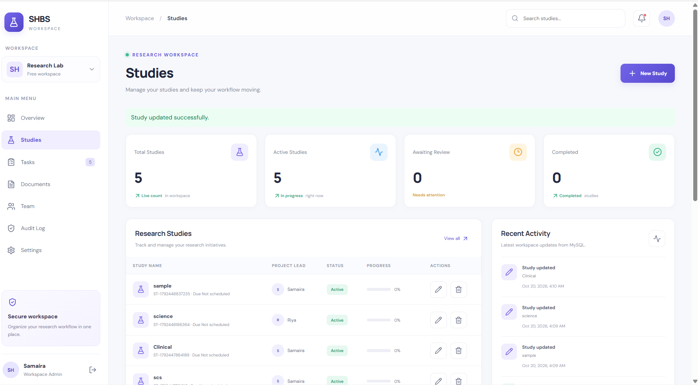
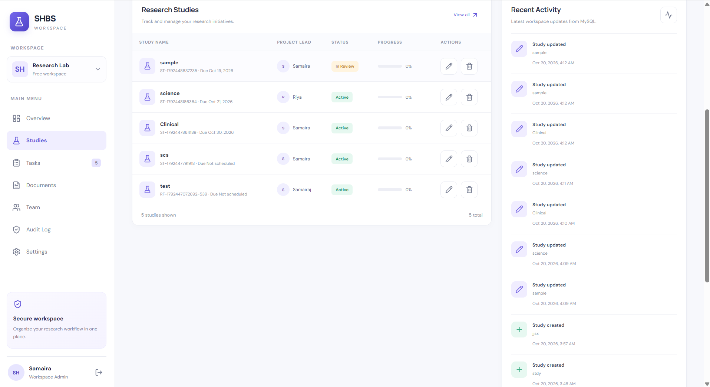
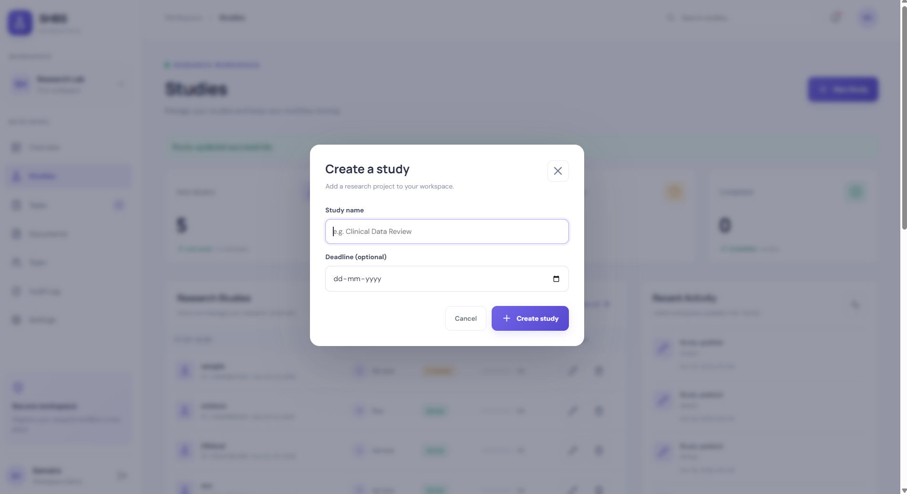

# SHBS ResearchFlow

A full-stack research study management dashboard designed to organize research studies, track progress, manage deadlines, and monitor recent activity.

**Built with React, TypeScript, Express.js, and MySQL.**

## 📸 Project Screenshots

### Dashboard


### Recent Activity and Deadlines


### Add Study Form


## ✨ Features

- **Study Management:** Create, view, update, and delete research studies.
- **Progress Tracking:** Track study status and completion progress.
- **Deadline Management:** Assign study deadlines and view upcoming or overdue studies.
- **Recent Activity:** Review recent actions performed on studies.
- **Dashboard Interface:** View study information through an organized dashboard.
- **Database Integration:** Store and retrieve study records using MySQL.
- **REST API:** Connect the frontend and backend through Express.js endpoints.

## 🛠️ Tech Stack

| Technology | Purpose |
|---|---|
| React | Frontend user interface |
| TypeScript | Type-safe application development |
| Vite | Frontend development server and build tool |
| CSS | Styling and responsive layout |
| Node.js | Backend runtime |
| Express.js | REST API |
| MySQL | Relational database |

## 🚀 Getting Started

### Prerequisites

Install the following before running the project:

- Node.js and npm
- MySQL Server
- Git

### 1. Clone the repository

```bash
git clone https://github.com/samaira90/SHBS-ResearchFlow.git
cd SHBS-ResearchFlow
```

### 2. Install frontend dependencies

```bash
npm install
```

### 3. Configure the database

Create a MySQL database named `shbs_researchflow`.

Navigate to the backend folder:

```bash
cd backend
npm install
```

Create a `.env` file inside `backend` using `.env.example` as a template. Add your local MySQL connection settings. Do not commit your real `.env` file.

Ensure the required database tables are created before starting the application.

### 4. Start the backend

From the `backend` directory, run:

```bash
npm run dev
```

Keep this terminal running.

### 5. Start the frontend

Open a second terminal, navigate to the project root, and run:

```bash
npm run dev
```

Open the local URL displayed by Vite in your browser.

## 📁 Project Structure

```text
SHBS-ResearchFlow/
├── backend/
│   ├── server.ts
│   ├── package.json
│   └── .env.example
├── public/
│   └── screenshots/
│       ├── dashboard.png
│       ├── activity-deadlines.png
│       └── add-study.png
├── src/
│   ├── App.tsx
│   ├── App.css
│   ├── index.css
│   └── main.tsx
├── package.json
└── README.md
```

## 🔒 Security

- Database credentials are stored in environment variables.
- The actual `.env` file should not be committed to version control.
- `.env.example` documents the configuration required to run the application.

## 👩‍💻 Author

**Samaira**

GitHub: [@samaira90](https://github.com/samaira90)

[View SHBS ResearchFlow on GitHub](https://github.com/samaira90/SHBS-ResearchFlow)

---

*Developed as a full-stack software development portfolio project.*